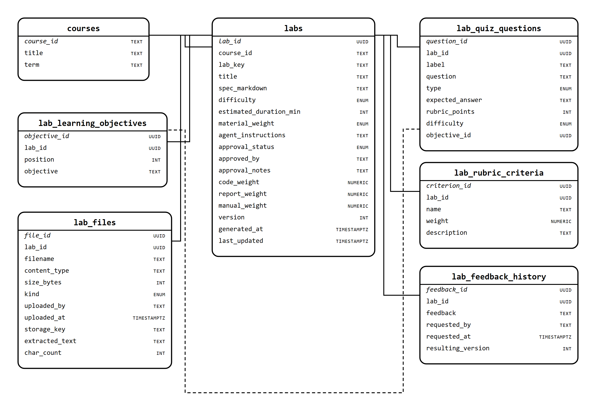

# Curriculum Designer — relational schema

The tabular form of the Curriculum Designer's data, as Dr. Kalathas asked for:
tables, typed columns, keys and relationships rather than Python classes.

- Diagram: `docs/erd.png` (generated by `scripts/make_erd.py`, source `docs/erd.svg`)
- DDL: `db/schema.sql` — PostgreSQL, ready for Supabase
- Derived from `models/curriculum.py` and `models/files.py`



Seven tables. Solid lines are foreign keys to `labs`; the dashed line is the
one optional reference, from a quiz question to the learning objective it
tests.

---

## courses

New. Nothing in the project defines a course today — `course_id` is a bare
string defaulting to `"csc580"` and points at nothing. A lab has to belong to
something.

| Column | Type | Key | Null | Default | Notes |
|---|---|---|---|---|---|
| `course_id` | TEXT | PK | no | — | e.g. `csc580` |
| `title` | TEXT | | no | — | |
| `term` | TEXT | | yes | — | e.g. `Fall 2026` |

## labs

One row per lab.

| Column | Type | Key | Null | Default | Notes |
|---|---|---|---|---|---|
| `lab_id` | UUID | PK | no | `gen_random_uuid()` | |
| `course_id` | TEXT | FK → `courses` | no | — | `on delete restrict` |
| `lab_key` | TEXT | | no | — | The human id, `lab4`. Unique **per course** |
| `title` | TEXT | | no | — | |
| `spec_markdown` | TEXT | | no | `''` | The lab handout |
| `difficulty` | ENUM | | no | `intermediate` | `basic` \| `intermediate` \| `challenge` |
| `estimated_duration_min` | INT | | no | `90` | `> 0` |
| `material_weight` | ENUM | | no | `balanced` | `strict` \| `balanced` \| `expansive` |
| `agent_instructions` | TEXT | | yes | — | Free-form instructor text |
| `approval_status` | ENUM | | no | `pending` | `pending` \| `approved` \| `needs_changes` |
| `approved_by` | TEXT | | yes | — | |
| `approval_notes` | TEXT | | yes | — | |
| `code_weight` | NUMERIC(4,3) | | no | `0.6` | 0–1 |
| `report_weight` | NUMERIC(4,3) | | no | `0.3` | 0–1 |
| `manual_weight` | NUMERIC(4,3) | | no | `0.1` | 0–1 |
| `version` | INT | | no | `1` | `>= 1`, bumped by request-changes |
| `generated_at` | TIMESTAMPTZ | | no | `now()` | |
| `last_updated` | TIMESTAMPTZ | | no | `now()` | |

**Unique:** `(course_id, lab_key)` — two courses may each have a `lab4`.
**Index:** `(course_id, approval_status)` for "labs awaiting approval".

The three rubric weights stay as columns because they are one-to-one with a
lab. Only the criteria list is a separate table.

## lab_learning_objectives

Was an array of strings on the lab.

| Column | Type | Key | Null | Notes |
|---|---|---|---|---|
| `objective_id` | UUID | PK | no | |
| `lab_id` | UUID | FK → `labs` | no | `on delete cascade` |
| `position` | INT | | no | Preserves the order the array gave for free |
| `objective` | TEXT | | no | |

**Unique:** `(lab_id, position)`.

## lab_quiz_questions

Was an embedded array.

| Column | Type | Key | Null | Notes |
|---|---|---|---|---|
| `question_id` | UUID | PK | no | |
| `lab_id` | UUID | FK → `labs` | no | `on delete cascade` |
| `label` | TEXT | | no | `q1`, `q2`, … unique within the lab |
| `question` | TEXT | | no | |
| `type` | ENUM | | no | `short_answer` \| `multiple_choice` \| `code` \| `essay` |
| `expected_answer` | TEXT | | no | Not shown to students |
| `rubric_points` | INT | | no | `>= 0` |
| `difficulty` | ENUM | | no | `basic` \| `intermediate` \| `challenge` |
| `objective_id` | UUID | FK → `lab_learning_objectives` | yes | `on delete set null` |

`objective_id` replaces `learning_objective_ref`, which was a free string that
had to match an objective exactly. Nothing enforced that, so a reworded
objective silently orphaned its questions.

## lab_rubric_criteria

| Column | Type | Key | Null | Notes |
|---|---|---|---|---|
| `criterion_id` | UUID | PK | no | |
| `lab_id` | UUID | FK → `labs` | no | `on delete cascade` |
| `name` | TEXT | | no | Unique within the lab |
| `weight` | NUMERIC(4,3) | | no | 0–1 |
| `description` | TEXT | | no | |

## lab_feedback_history

Append-only; one row per "request changes".

| Column | Type | Key | Null | Notes |
|---|---|---|---|---|
| `feedback_id` | UUID | PK | no | |
| `lab_id` | UUID | FK → `labs` | no | `on delete cascade` |
| `feedback` | TEXT | | no | What the instructor asked for |
| `requested_by` | TEXT | | no | |
| `requested_at` | TIMESTAMPTZ | | no | |
| `resulting_version` | INT | | no | Version produced **after** applying it |

## lab_files

Metadata and extracted text. **The bytes are not here** — they belong to the
shared file storage from task 3; `storage_key` is the pointer.

| Column | Type | Key | Null | Default | Notes |
|---|---|---|---|---|---|
| `file_id` | UUID | PK | no | `gen_random_uuid()` | |
| `lab_id` | UUID | FK → `labs` | no | — | `on delete cascade` |
| `filename` | TEXT | | no | — | |
| `content_type` | TEXT | | no | `application/pdf` | |
| `size_bytes` | INT | | no | — | `>= 0` |
| `kind` | ENUM | | no | `material` | `material` \| `instructions` |
| `uploaded_by` | TEXT | | yes | — | |
| `uploaded_at` | TIMESTAMPTZ | | no | `now()` | Also the list order |
| `storage_key` | TEXT | unique | no | — | `labs/{course_id}/{lab_key}/{file_id}/{filename}` |
| `extracted_text` | TEXT | | no | `''` | Per file, so one can be removed without re-parsing |
| `char_count` | INT | | no | `0` | |

---

## What changed moving from documents to tables

| Document model | Relational | Why |
|---|---|---|
| `quiz[]` embedded | `lab_quiz_questions` | Queryable on its own; a question gets a real id |
| `rubric.criteria[]` embedded | `lab_rubric_criteria` | Same |
| `feedback_history[]` embedded | `lab_feedback_history` | Append-only log; grows without bound inside a row otherwise |
| `learning_objectives[]` strings | `lab_learning_objectives` | So a quiz question can point at one |
| `learning_objective_ref` string | `objective_id` FK | Enforced instead of matched by text |
| `rubric` weights | columns on `labs` | One-to-one; a table would add a join for nothing |
| `material_content` string | **view** `lab_material_content` | See below |
| `lab_id` as the key | `(course_id, lab_key)` unique | `lab_id` alone was never unique across courses |
| no course table | `courses` | `course_id` referenced nothing |

### material_content becomes a view

In MongoDB this was a denormalised string on the lab, rebuilt by hand on every
upload and delete — three write paths that each had to remember. In SQL it is
a view over `lab_files`, so it cannot go stale:

```sql
select material_content from lab_material_content where lab_id = $1;
```

The view emits the same format the generation prompts already consume
(`[Document N: filename]`, separated by a rule), so the prompt code is
unchanged.

---

## Supabase notes

- **RLS is not optional.** Supabase publishes every table over PostgREST. The
  DDL enables row level security on all seven with no policies, which denies
  everything by default; the agent uses the service role key, which bypasses
  it. Per-course policies come when instructor accounts are real — Microsoft
  auth is post-integration per ui-instructor#8.
- `gen_random_uuid()` is built in on Supabase; no extension needed.
- The SQL editor will run `db/schema.sql` as-is.

---

## Status and open questions

**The DDL has not been run against a live PostgreSQL.** There is no Postgres or
Docker on this machine, and I did not want to install a database service to
check. It parses as PostgreSQL, but that is not the same as running. Whoever
brings up the Supabase project should paste `db/schema.sql` into the SQL editor
first — it will validate in seconds, and I will fix anything it reports.

1. **This supersedes MongoDB, which is already built and merged.** See the note
   below.
2. **Who owns `courses`?** It is defined here because labs need it, but
   students, submissions and grades from tasks 1 and 3 will all want it too. It
   probably belongs in a shared core rather than in this agent's schema.
3. **Version history still is not retained.** Request-changes overwrites the
   quiz and rubric. A `lab_versions` table holding a snapshot per version is
   the fix; cheap now, a migration later.
4. **`storage_key` format** needs confirming with whoever builds task 3's file
   storage.

### On MongoDB vs Supabase

Worth deciding explicitly before more code is written, because the two are now
in conflict:

- Dr. Kalathas created the project's **MongoDB** account alongside Vercel and
  Upstash, and an Atlas cluster exists.
- `curriculum-designer#6` is **merged**: `MongoStore`, `MongoFileStore`, the
  `labs` and `lab_files` collections.
- `curriculum-designer#8` is open: `$jsonSchema` validators for those
  collections.
- This document and `db/schema.sql` describe **PostgreSQL** instead.

The relational model is a genuinely better fit for this data — the embedded
arrays all want to be tables, and `material_content` stops being a thing anyone
can forget to rebuild. But switching means replacing the storage layer, not
just the schema, and the same decision lands on tasks 1 and 3.

The tables and the diagram above are useful either way: they are the data
model, independent of the engine.
